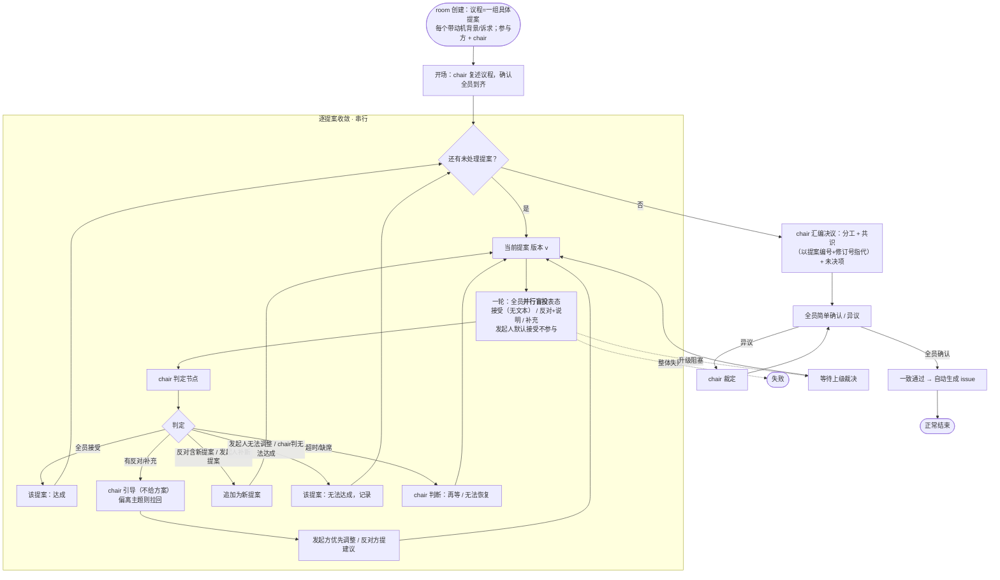

# agentmoot — room 核心流程

> 状态：已定（2026-11-11）
> 本文是 room 多点讨论流程的权威细化，承接 `design.md` 第 4 节；实现见 `implementation.md`。

## 1. 核心对象

- **Room**：会议，含 `title`、`participants[]`（参与项目）、`chair`（独立第三方）。
- **Proposal（提案）**：议程的最小单元。**议程 = 一组具体提案**，每个提案自带动机背景 / 诉求，而不是"待解决问题"。
  - 提案有**版本号**：每次调整 = v+1，保留历史可审计。
- **Statement（表态）**：参与方对某提案某版本的一次表态，三态（见 §3）。
- **Resolution（决议）**：chair 汇编的最终产出，含分工 / 共识 / 未决项。

## 2. 整体流程

## 3. 表态三态

| 表态 | 语义 | 后果 |
|---|---|---|
| **接受** | 同意当前版本提案 | — |
| **反对** | 否决当前版本 + **附说明**（原因/自身项目约束/需求，可含新提案） | 见 §4 |
| **补充** | 调整提案内容（**双向奔赴**）：发起方迁就反对方，或反对方在守住自身约束前提下满足提案方诉求 | 提案 **v+1 后重新表决** |

- 反对的说明可适当结构化，实践中逐步细化。
- 表态是**严格 tool call**，无幻觉、无二义。

## 4. 反对 → 新提案

- 一轮内**全员并行盲投**，提交前看不到别人本轮表态，到齐后一起公开。
- 存在反对时：
  1. **反对中含新提案** → 追加为新提案；
  2. **反对后提案发起人补充新提案**（发起人有优先调整权）→ 追加为新提案；
  3. 发起人认为**无法调整** → 该提案进入"无法达成"。
- **否决 ≠ 终止**：可继续驱动找替代方案，否决也可能最终达成共识。

## 5. chair 职责

- 拥有议程细节的完整知识；**只引导，不主动给方案**。
- 从常规共识决策角度给建议；**发言偏离主题过多时负责拉回**（germaneness）。
- 形成**结构化纪要**与观点汇总。
- **轮次推动走自动化流程，chair 只在预定节点介入**：
  - 开场：复述议程、确认到齐；
  - 每轮判定节点：判定 达成 / 继续引导 / 无法达成 / 再等 / 无法恢复；
  - 阶段 D：汇编决议、裁定异议。
- **升级由 chair 发起**，标准由 chair 掌握。
- 可**检查参会 Agent 状态**（静默检查），区分"真没到"与"人没了"。

## 6. 阶段 D 决议确认

- 决议草案用**提案编号 + 修订号**指代（A 提案 v2、B 提案 v1），不重复细节。
- 最后一轮全员确认的是"一致通过了 A、B……"**这个事实本身**。
- 确认轮表态：**简单确认 / 异议**；异议由 **chair 裁定**。
- 一致通过 → 自动生成 issue（决议来源 issue 效力不同，见 design.md §4）。

## 7. 超时 / 缺席 / 升级 / deadline

- **超时/缺席**：由 chair 综合判断"再等等"还是"无法恢复"（结构化决策 `wait` / `unrecoverable`）。
- **升级**：chair 发起，投递给声明的上级（默认人），可阻塞等待裁决后继续。
- **deadline**：暂不硬设；轮内超时靠 chair 判断。
- **防无限发散**：硬上限 5 轮（确定性兜底，进状态机）；chair 提示词引导 3 轮无法共识则视情况判 unresolvable。

## 8. 已定 vs 待定

**已定**：
- 并行盲投、逐提案串行、三态表态、反对→新提案、chair 只引导、升级由 chair、决议事实确认、无硬 deadline。
- 补充整合者 = 发起方（吸收各方意见后出修订版）。
- 轮数上限 = 5 轮（确定性兜底）；chair 提示词说明 3 轮无法共识则视情况判 unresolvable。
- 提案处理 = 串行；依赖关系暂不实现。
- 立场/诉求阶段（原 B 阶段）暂不做。
- 修订方「简版方向」不刻意约束，简洁表达清楚即可。

**待定（留待评测/后续）**：
1. 提案版本号的呈现方式 → 留待评测；
2. 提案依赖关系（并行依赖项）→ 后续；
3. 立场/诉求（原 B 阶段）→ 实际实验后追加。
